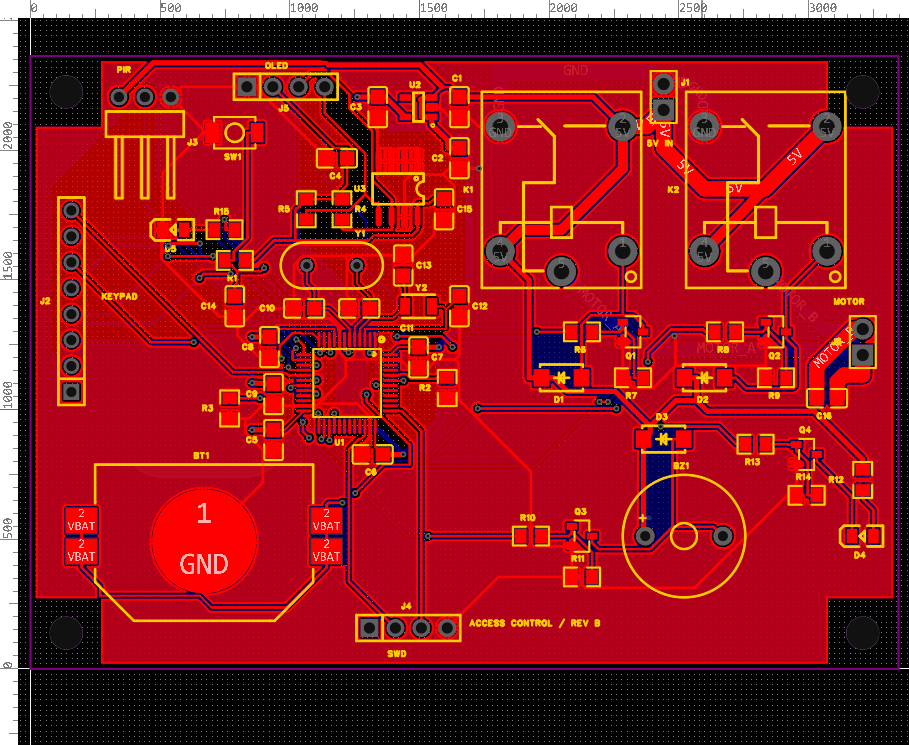

# GPT + 嘉立创 EDA 专业版半自动设计密码门禁系统

以 STM32F103C8T6、外接 4×4 矩阵键盘、EEPROM/OLED、RTC 后备与双继电器电机输出为课程案例，探索 AI 辅助原理图和 PCB 设计。接入链路为 Codex → 本机 Python/PowerShell → HTTP bridge → WebSocket → Run API Gateway → eda.* API。需求、选型、布局和验收仍需人工参与。

归档日期：2026-11-04（Asia/Shanghai）。本次只做本地离线归档，没有连接 EDA、切换文档、重新运行 DRC 或保存工程。

|状态|结论与证据|
|---|---|
|已验证：保存的 PCB 快照|56 器件、41 非空网络、191 项器件焊盘条目、638 段铜线、51 过孔、2 块固定 GND FILL。严格 DRC=true、错误列表为空、saved=true、56 位号可见。见 [原始验收 JSON](validation/PCB3_final_verified.json)、[离线重比结果](validation/offline-evidence-check.json)|
|已验证：离线原理图连接对照|[173 项预期连接](validation/eda_connections.json) 与 [回读网表](hardware/schematic/eda_final.json) 逐项一致；56 器件、保存 true|
|历史记录：原理图检查|[绘制报告](docs/original/密码门禁_绘制报告.md) DRC=false；尚无最终 ERC/DRC 通过证据|
|待确认：完整工程与制造|文本源不是已验证可异机恢复的完整原生工程包；生产包、采购 BOM 未完成验证|
|计划：固件和实物|固件、打样、焊接、起振、EMC、电机堵转及整机功能测试未验证完成|

[PCB 原始源](hardware/pcb/PCB3_final_source.txt) 与验收 JSON 内 source 统一 CRLF/LF 后一致，原始字节并不相同，两个哈希分别记录在离线结果中。初始焊盘基准逐项比较一致（含同号重复焊盘）。所有原始归档文件字节不变，没有生成脱敏副本。

[底层预览](hardware/pcb/PCB3-bottom.png)仅为历史视觉证据，不能替代制造包。地铜为固定 FILL，设计变更后必须重新计算。

- [接入架构与历史环境](docs/architecture.md)
- [操作流程与人工检查点](docs/workflow.md)
- [验证结果及限制](docs/validation.md)
- [失败经验与已知问题](docs/lessons.md)
- [进度与待办](docs/progress.md)
- [来源、依赖和授权](references/README.md)
- [原始交接](docs/original/PROJECT_HANDOFF.md)、[原始清单](docs/original/PROJECT_FILE_MANIFEST.json)
- [历史脚本逐项审阅](scripts/historical/README.md)、[提示词记录](prompts/README.md)

复现边界：脚本依赖案例坐标、旧快照、硬编码本机路径和人工操作；仅归档有代表性的脚本及布线中间产物，未收集全部历史输入，不提供从空工程一键恢复。唯一新增可执行入口是 [离线归档检查器](validation/verify_archive.py)，只验证本地文件，不连接 EDA。历史命令的成功只适用于原记录，不能当作完整流水线复现证明。

预算为 [2026-11-04 历史估算](docs/original/密码门禁_方案与成本估算.md)，不是当前采购报价；其中“PCB 尚未完成”是原理图阶段状态，已被后续 PCB 快照替代，原文保留供追溯。

最先推进：完整工程备份及独立恢复验证；原理图问题闭环与电机/电源校核；设计稳定后开发固件最小工程并制定样机验收计划。任何设计操作另行明确任务后进行。
